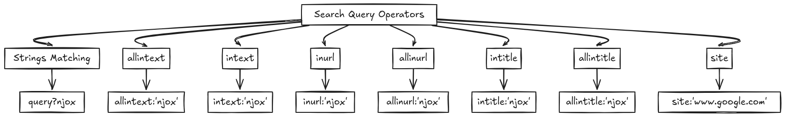

## Functional Requirements

- User will be able to enter the query text they want to perform just a word. Example

```sh
# assume they are dorking for this word
njox/
```

The question: How do I preview the results of the project.

- After the user has entered query we will provide results based on query for the following things only for `version 1` of the project.

The following are the list of category that will be used first.

| Category         | Meaning / Query Example                                                                                      |
| ---------------- | ------------------------------------------------------------------------------------------------------------ |
| Strings matching | `"query"` — assumes the user has searched for this query. Example: `"query?njox"`                            |
| allintext        | Search for pages containing **all** the specified keywords in the text. Example: `allintext:"njox security"` |
| intext           | Search for pages containing the keyword **anywhere** in the text. Example: `intext:"njox"`                   |
| inurl            | Search for URLs containing the keyword. Example: `inurl:"njox"`                                              |
| allinurl         | Search for URLs containing **all** specified keywords. Example: `allinurl:"njox tools"`                      |
| intitle          | Search for pages with the keyword **anywhere** in the title. Example: `intitle:"njox"`                       |
| allintitle       | Search for pages with **all** specified keywords in the title. Example: `allintitle:"njox osint"`            |
| site             | Restrict search results to a specific site. Example: `site:"example.com"`                                    |
| filetype         | Search for files of a specific format. Example: `filetype:"pdf"`                                             |
| link             | Find external pages linking to a URL/page. Example: `link:"njox.com"`                                        |
| numrange         | Search within a numeric range. Example: `numrange:321-325`                                                   |
| before / after   | Filter results by date. Example: `filetype:pdf before:2000-01-01 after:1999-01-01`                           |
| inanchor         | Search for keywords in anchor text (links pointing to a page). Example: `inanchor:"njox"`                    |
| allinanchor      | Anchor text must contain **all** keywords. Example: `allinanchor:"njox cyber"`                               |
| inpostauthor     | Blog search: posts written by an author. Example: `inpostauthor:"njox"`                                      |
| allinpostauthor  | Must match **all** keywords in author field. Example: `allinpostauthor:"njox" "lee"`                         |
| related          | Show pages similar to a given page. Example: `related:www.google.com`                                        |
| cache            | Show Google’s cached version of a page. Example: `cache:www.google.com`                                      |



- Generate reports based on query and gives visualizations about the query made.
